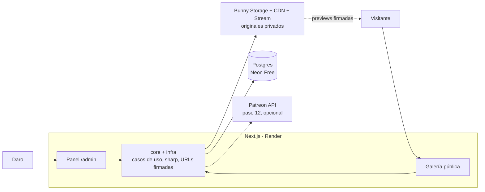

# Documentación técnica: Galería NightDaro

Oct 29, 2026 · @Damian

La primera versión es una sola app Next.js solo para NightDaro: galería pública y panel de administración, con Postgres y Bunny, por unos US$9/mes. La lógica va en capas separadas de Next.js, así, si funciona, se convierte en el SaaS multi-tenant sin reescribir el dominio.

## Stack

| Capa | Tecnología | Por qué |
| --- | --- | --- |
| App | Next.js 15 (App Router) + Tailwind CSS 4 + shadcn/ui | Galería y panel `/admin` en un solo servicio, con Server Components y Server Actions, sin API aparte |
| Lógica de negocio | `src/core` en TypeScript puro | Entidades, casos de uso y puertos que no importan Next.js; se pueden llevar a NestJS en la fase SaaS |
| Validación | Zod | Los mismos esquemas en formularios y Server Actions |
| Base de datos | PostgreSQL 16 en Neon Free + Drizzle ORM | Gratis al inicio, migraciones versionadas, SQL explícito |
| Login | Auth.js v5 con credenciales | Solo Daro y Dami entran al panel; sin registro público |
| Imágenes | sharp + file-type | Miniatura, preview con marca de agua y versión censurada, generadas al subir |
| Archivos y CDN | Bunny Storage + Pull Zone con token auth | Acepta contenido adulto, URLs firmadas que vencen |
| Video | Bunny Stream | Timelapses en HLS con marca de agua, sin exponer el MP4 |
| Métricas | Tabla `events` propia + links `/r/[code]` | Visitas y clics por tier o red sin servicios externos |
| DNS y correo | Cloudflare DNS, Registrar y Email Routing | Dominio y casilla de contacto sin costo extra |
| Errores | Sentry (plan gratis) | Avisos de fallas en producción |
| Tests y CI | Vitest, Playwright, GitHub Actions | Checks en cada PR |

NestJS, pg-boss, RLS y el login de varios talentos quedan para la fase SaaS: con un solo artista no suman nada y duplican el deploy.

### Next.js frente a otras opciones

| Opción | Galería | Panel de administración | Veredicto |
| --- | --- | --- | --- |
| Next.js | SSR, buenas previews en X y Reddit, puerta +18 en el servidor | App React completa en la misma app | Elegido: una sola app y React |
| Astro | La más rápida, casi sin JS | Islas de React en todas partes o una app aparte | Mejor si el panel fuera otra app |
| HTML, CSS y JS puro | Liviano y barato | Todo a mano | Las previews al compartir salen vacías porque los bots no ejecutan JS |
| React Router v7, SvelteKit, Nuxt | Buenas | Buenas | Sin ganancia clara; Svelte y Vue no están en el stack |

Con Server Components el navegador recibe HTML y CSS casi puros; solo las pestañas, el lightbox y el modal +18 llevan JS.

## Arquitectura

Todo pasa por una app Next.js: el visitante ve la galería, Daro usa el panel, y solo el servidor toca Postgres y los originales.



El navegador pide las previews directo al CDN de Bunny con URLs que firma el servidor y vencen en una hora. Patreon se suma en el paso opcional 12.

## Estructura del repo

Un repo con una sola app. Las carpetas `core` e `infra` separan la lógica de Next.js para poder migrarla después.

```text
galeria-nightdaro/
├─ src/
│  ├─ app/
│  │  ├─ (gallery)/            # /, /obra/[slug], /en-proceso, /timelapses, /apoyar
│  │  ├─ admin/                # resumen, subir, galeria, pagina, links
│  │  ├─ login/
│  │  ├─ r/[code]/route.ts     # cuenta el clic y redirige
│  │  └─ api/events/route.ts   # registra vistas desde el cliente
│  ├─ core/                    # sin imports de next ni drizzle
│  │  ├─ artworks/             # entidad, casos de uso, puerto del repositorio
│  │  ├─ media/  site/  links/  analytics/
│  ├─ infra/                   # repositorios Drizzle, adaptador Bunny, sharp
│  │  └─ container.ts          # arma los casos de uso con sus adaptadores
│  ├─ db/                      # schema.ts, migrations/, seed.ts
│  ├─ components/              # ui/, gallery/, admin/
│  └─ middleware.ts            # puerta +18 y protección de /admin
├─ docs/arquitectura.md
└─ docker-compose.yml          # Postgres local
```

- **Regla de dependencias:** `app/` llama a los casos de uso a través de `infra/container.ts`, y `core/` nunca importa Next.js ni Drizzle (regla de ESLint).
- **Puertos y adaptadores:** `StoragePort`, `VideoPort` y `ArtworkRepository` se implementan en `infra/` y se reemplazan por fakes en los tests.
- **Caso de uso por acción:** `UploadArtwork`, `PublishArtwork`, `ReorderGallery`, fáciles de testear sin Next.js.
- **Strategy:** presets de imagen (miniatura, preview con marca de agua, censurada) elegidos según el rating.

## Modelo de datos

Siete tablas, sin `tenant_id`: la configuración del sitio es una sola fila.

| Tabla | Campos clave | Notas |
| --- | --- | --- |
| `site_settings` | id (siempre 1), name, bio, banner\_media\_id, theme jsonb, socials jsonb, age\_gate\_enabled, seo jsonb | Lo que se edita en Página pública |
| `users` | id, email, password\_hash, created\_at | Daro y Dami |
| `artworks` | id, slug, title, description, kind, rating, status, position, tags text\[\], published\_at | kind: finished, wip, timelapse; rating: sfw, suggestive, explicit; status: draft, published, hidden |
| `media_assets` | id, artwork\_id, type, original\_key, preview\_key, thumb\_key, censored\_key, blur\_data, width, height, stream\_video\_id, status | El original vive en la zona privada |
| `tiers` | id, platform, name, price\_cents, currency, url, position | platform: patreon, onlyfans, fansly |
| `tracking_links` | id, code, target\_url, label, tier\_id | `/r/{code}` cuenta el clic |
| `events` | id, type, artwork\_id, link\_id, session\_hash, referrer, country, created\_at | type: view, click, age\_ok; sin IP |

El seed crea `site_settings` de NightDaro, sus tiers de Patreon de ejemplo (US$5, 10 y 20) y sus redes (Instagram nightdaro, X @nightcrowller3).

## Rutas y acciones

Sin API REST pública: las páginas leen con Server Components y el panel escribe con Server Actions que llaman a los casos de uso.

| Ruta | Tipo | Qué hace |
| --- | --- | --- |
| `/`, `/en-proceso`, `/timelapses` | Página pública | Galería por pestaña, con ISR |
| `/obra/[slug]` | Página pública | Detalle con Open Graph propio |
| `/apoyar` | Página pública | Tiers de Patreon, OnlyFans y Fansly |
| `/r/[code]` | Route handler | Registra el clic y redirige (302) |
| `/api/events` | Route handler | Registra vistas y aceptación de la puerta +18 |
| `/login` | Página | Acceso al panel |
| `/admin` | Panel | Resumen de visitas y clics |
| `/admin/subir` | Panel + Server Action | Subir obras y timelapses |
| `/admin/galeria` | Panel + Server Actions | Ordenar, editar, ocultar y borrar |
| `/admin/pagina` | Panel + Server Action | Banner, bio, tema, puerta +18 y redes |
| `/admin/links` | Panel + Server Actions | Tiers y links de seguimiento |

Cada Server Action valida con Zod, verifica la sesión y llama a `revalidatePath` para actualizar la galería.

## Pipeline de imágenes y protección

El original nunca es accesible desde internet: la galería solo sirve copias reducidas, con marca de agua y por URLs que vencen.

1. Daro sube el archivo en `/admin/subir`. Se valida el tipo por magic bytes (JPG, PNG o WebP; nada de SVG), hasta 30 MB, y se borran los metadatos EXIF.
2. El original va a la zona de Bunny Storage `originals`, que no tiene Pull Zone ni URL pública.
3. En la misma acción, sharp genera la miniatura de 400 px, la preview de 1600 px con marca de agua en mosaico (logo y @nightdaro, 25% de opacidad) y un placeholder borroso. Con un solo artista no hace falta cola de trabajos.
4. Si el rating es `explicit`, la versión pública es la censurada que sube Daro, o un blur fuerte automático si no la sube.
5. Las variantes van a la zona `public-media`, detrás de una Pull Zone con Token Authentication y referrers permitidos.
6. El servidor firma cada URL con una expiración de 1 hora al renderizar la galería.

Timelapses: el panel sube el video directo a Bunny Stream por TUS con una firma que emite el servidor, y Stream lo sirve en HLS con token auth y marca de agua.

Las capturas de pantalla no se pueden impedir. La defensa real es que lo que circula tiene baja resolución y la firma de Daro, y lleva tráfico de vuelta a su página.

## Acceso al panel

- Auth.js v5 con credenciales; contraseñas con argon2id; solo los usuarios del seed, sin registro.
- Sesión en cookie `httpOnly` y `Secure` de 30 días; el middleware bloquea `/admin` sin sesión.
- Rate limit de 5 intentos por minuto en el login.
- Un solo rol (admin): Daro y Dami pueden todo.

## Integraciones

- **Tiers:** la galería nunca enlaza directo; pasa por `/r/{code}`, que cuenta el clic.
- **OnlyFans y Fansly:** Daro pega su tracking link como tier; los suscriptores se miran en el panel de cada plataforma.
- **Patreon (paso opcional 12):** OAuth de solo lectura sobre la cuenta de Daro y webhooks de altas y bajas, para ver en el Resumen cuántos clics terminan en suscripción. Confirmar scopes y firma en [docs.patreon.com](https://docs.patreon.com).

## Deploy y costos

Un solo servicio en Render que despliega desde `main`.

| Servicio | Proveedor | Plan | Costo aprox. |
| --- | --- | --- | --- |
| App Next.js | Render Web Service | Starter | US$7/mes |
| Postgres | Neon | Free | US$0 |
| Storage, CDN y Stream | Bunny | Pago por uso | \~US$1/mes |
| Dominio, DNS y correo | Cloudflare | Free + Registrar | \~US$10/año |
| Errores | Sentry | Developer | US$0 |

Total: unos US$9/mes. El plan gratis de Render no sirve porque el servicio se duerme y la primera visita tarda.

Variables de entorno (en Render, nunca en el repo): `DATABASE_URL`, `AUTH_SECRET`, `BUNNY_STORAGE_KEY`, `BUNNY_ZONE_ORIGINALS`, `BUNNY_ZONE_PUBLIC`, `BUNNY_CDN_HOST`, `BUNNY_TOKEN_KEY`, `BUNNY_STREAM_LIBRARY_ID`, `BUNNY_STREAM_API_KEY`, `SITE_URL`, `SENTRY_DSN`.

## Seguridad, puerta +18 y moderación

La galería no muestra contenido explícito, solo previews censuradas detrás de una puerta +18 en el servidor; lo explícito queda en Patreon.

- **Puerta +18:** modal en la primera visita; al aceptar se guarda la cookie `age_ok` por 1 año. Sin la cookie, el servidor no renderiza obras `suggestive` ni `explicit`; no es un blur con CSS.
- **Crawlers y previews de redes:** reciben solo obras `sfw`.
- **Etiquetas:** `<meta name="rating" content="adult">` y la etiqueta RTA para filtros parentales.
- **Contenido:** rating obligatorio al subir; nada de personajes con aspecto infantil (art. 128 del Código Penal) ni el fan art de Mandark.
- **Aplicación:** Zod en cada acción, CSP y headers de seguridad, verificación de sesión en cada Server Action, secretos solo en Render, backups de Neon, métricas sin IP (`session_hash` diario con sal).

## Preparado para el SaaS

Hoy se hace lo mínimo que abarata la migración, sin pagar su complejidad.

| Ahora (NightDaro) | Al pasar a multi-tenant |
| --- | --- |
| `core/` sin dependencias de Next.js | Se reusa tal cual, desde Next.js o desde una API NestJS |
| Repositorios detrás de puertos | Se agrega `tenant_id` al repositorio, no a cada pantalla |
| `site_settings` como una sola fila | Pasa a una fila por tenant |
| Claves de Bunny con prefijo `nightdaro/` | Cada tenant ya tiene su carpeta |
| Esquemas Zod en una carpeta propia | Se mueven a `packages/contracts` en un monorepo |
| Un rol admin | Se suman owner, editor y platform\_admin |

La migración completa (tabla `tenants`, `tenant_id` con default NightDaro, RLS, middleware por host, NestJS, Patreon por talento y cobro) está descripta en el archivo docs-tecnicos/arquitectura-saas-multitenant.md del proyecto, la versión anterior de este documento.

## Decisiones abiertas

- [ ] Dominio de NightDaro.
- [ ] URL de su Patreon y sus tiers reales.
- [ ] Si se hace el paso 12 (Patreon) antes o después del lanzamiento.
